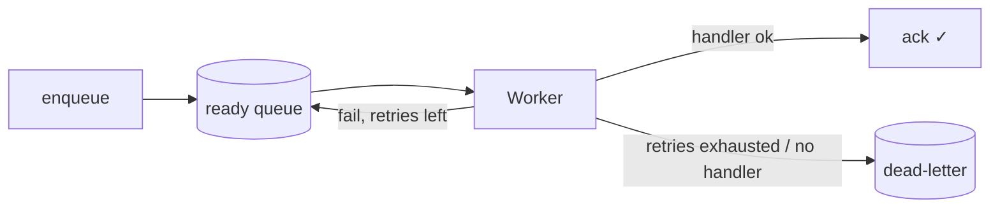

<p align="center">
  
</p>

<h1 align="center">Redis Queue Worker</h1>

<p align="center">
  <strong>A job queue worker with retries and a dead-letter queue — pluggable backend, pure Python.</strong><br>
  Enqueue jobs, dispatch them to named handlers, retry failures, and dead-letter what won't succeed.
</p>

<p align="center">
  <em>Built and maintained by <a href="https://viprasol.com">Viprasol Tech</a> — Fintech Experts. Full-Stack Builders.</em>
</p>

<p align="center">
  <a href="https://github.com/Viprasol-Tech/redis-queue-worker/actions/workflows/ci.yml"></a>
  <a href="LICENSE"></a>
  
  <a href="https://t.me/viprasol_help"></a>
  <a href="https://github.com/Viprasol-Tech/redis-queue-worker/stargazers"></a>
</p>

---

## ✨ Features

- 🔌 **Pluggable backend** — one `QueueBackend` protocol (`push` / `pop` / `ack` / `nack` / `dead_letter`); swap storage without touching the worker.
- 🧠 **In-memory backend included** — fully functional, FIFO, zero dependencies; perfect for tests and local runs.
- 🔁 **Retries with a budget** — a failed job is re-enqueued up to `max_retries` times before it gives up.
- ⚰️ **Dead-letter queue** — exhausted jobs (and jobs with no handler) are routed aside, never lost.
- 🧩 **Named handlers** — register `name -> handler`; the worker dispatches each job to the right one.
- 🖥️ **CLI** — `redis-queue-worker demo` runs the whole pipeline offline, no Redis required.
- ⚙️ **Modern tooling** — ruff, mypy (strict), pytest, GitHub Actions CI.

## 🚀 Quickstart

```bash
git clone https://github.com/Viprasol-Tech/redis-queue-worker.git
cd redis-queue-worker
python -m pip install -e ".[dev]"

# Enqueue jobs and run the worker on the in-memory backend:
redis-queue-worker demo
```

## 🧩 Use it in code

```python
from redis_queue_worker.backend import InMemoryBackend
from redis_queue_worker.job import Job
from redis_queue_worker.worker import Worker

backend = InMemoryBackend()
worker = Worker(backend)


@worker.handler("email")
def send_email(payload: dict[str, object]) -> None:
    print("sending to", payload["to"])


backend.push(Job(name="email", payload={"to": "ada@viprasol.com"}))
backend.push(Job(name="flaky", max_retries=2))  # no handler -> dead-letter

stats = worker.run()
print(stats)  # WorkerStats(processed=1, retried=0, dead_lettered=1)
print(backend.dead)  # the dead-lettered "flaky" job
```

A real Redis backend can be added by implementing the `QueueBackend` protocol with a `redis` client; the bundled `InMemoryBackend`
mirrors this interface over `RPOPLPUSH`-style reliable queues — wire in a
`redis` client to enable it. The in-memory backend is fully functional today.

## 🏗️ Architecture



## 🗺️ Roadmap

- [x] In-memory backend + worker with retries and dead-letter
- [x] Pluggable `QueueBackend` protocol + named handler registry
- [ ] Live Redis `QueueBackend` implementation (reliable `RPOPLPUSH` queue)
- [ ] Delayed/scheduled jobs and exponential backoff
- [ ] Concurrency: multiple worker processes and visibility timeouts

## 🤝 Contributing

PRs welcome — see [CONTRIBUTING.md](CONTRIBUTING.md) and our [Code of Conduct](CODE_OF_CONDUCT.md).

## Contact — Viprasol Tech Private Limited

- Website: [viprasol.com](https://viprasol.com)
- Email: [support@viprasol.com](mailto:support@viprasol.com)
- Telegram: [t.me/viprasol_help](https://t.me/viprasol_help) | WhatsApp: +91 96336 52112
- GitHub: [@Viprasol-Tech](https://github.com/Viprasol-Tech) | [LinkedIn](https://www.linkedin.com/in/viprasol/) | X [@viprasol](https://twitter.com/viprasol)

## License

[MIT](LICENSE) (c) 2025 Viprasol Tech Private Limited
